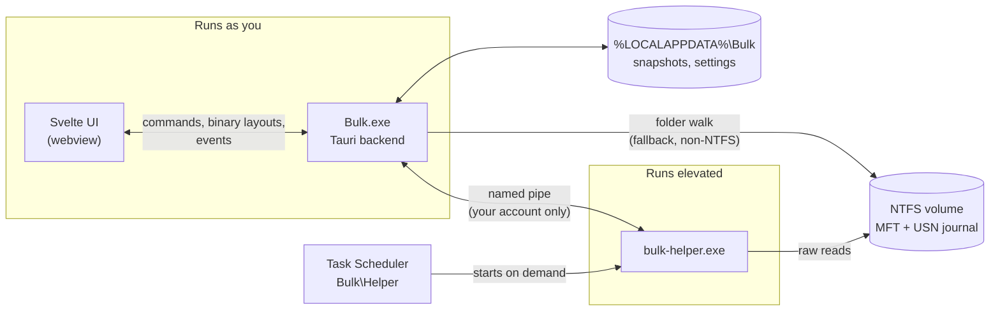
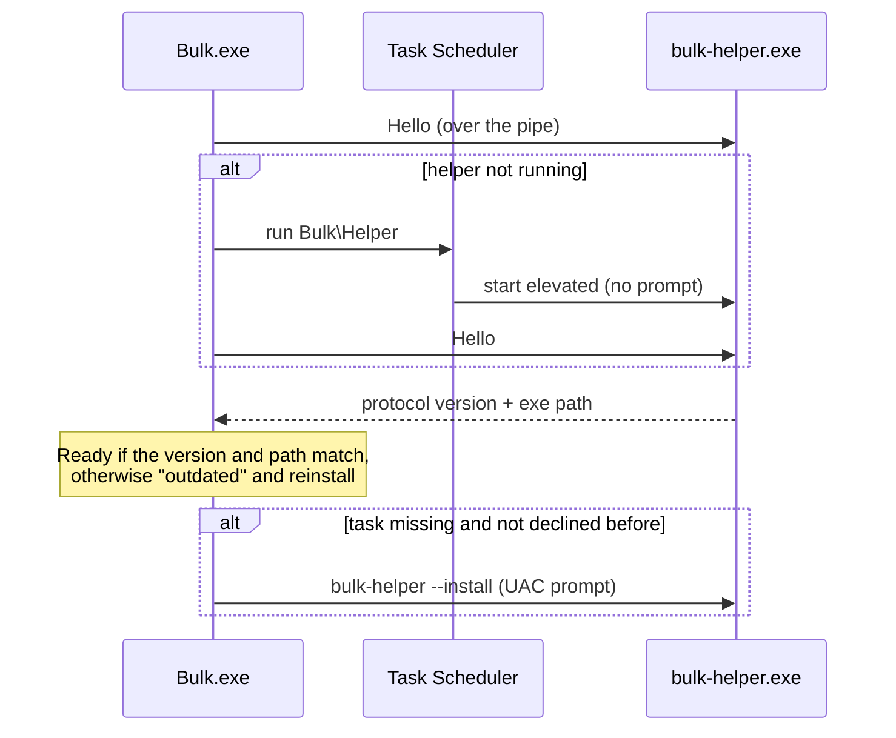
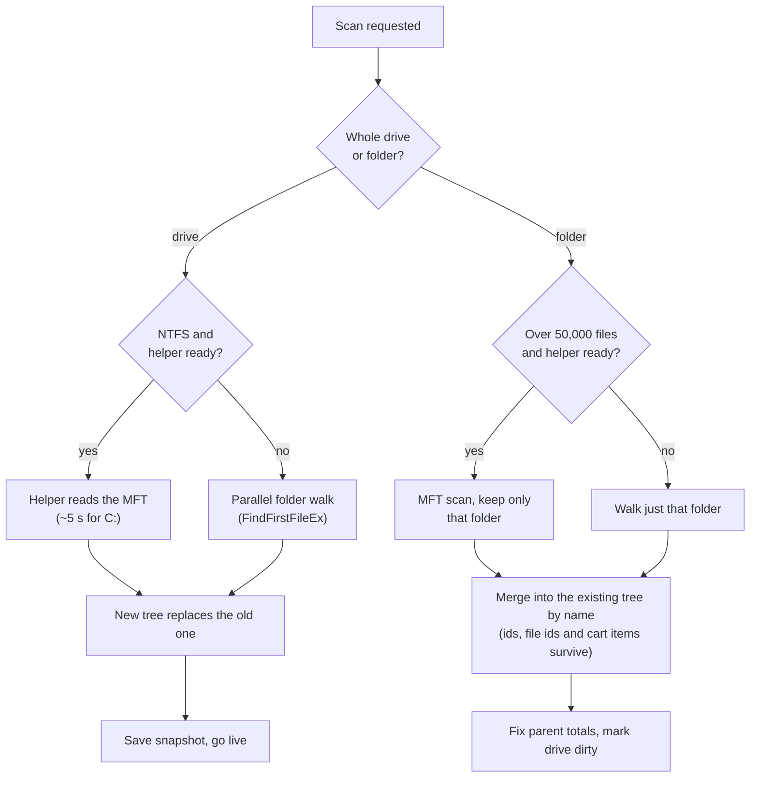
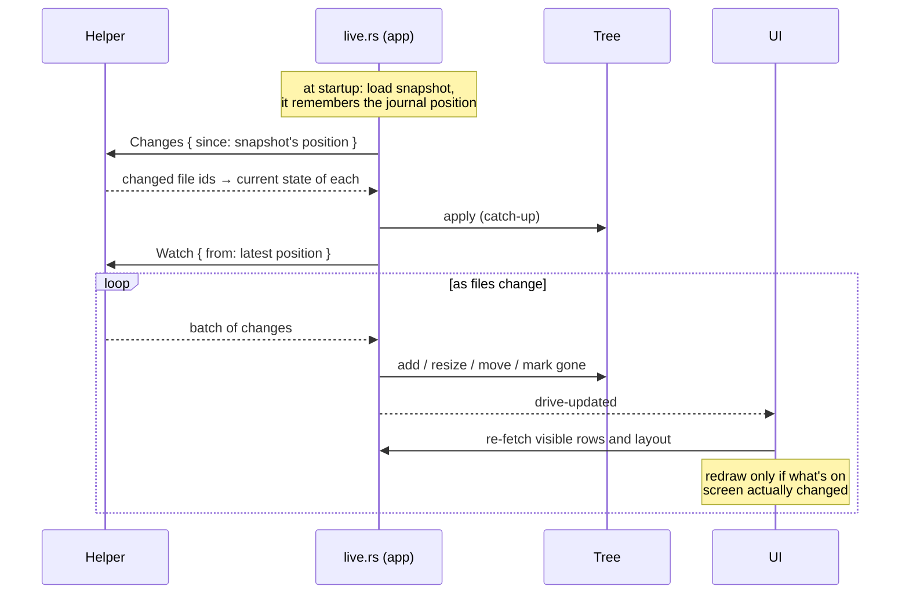
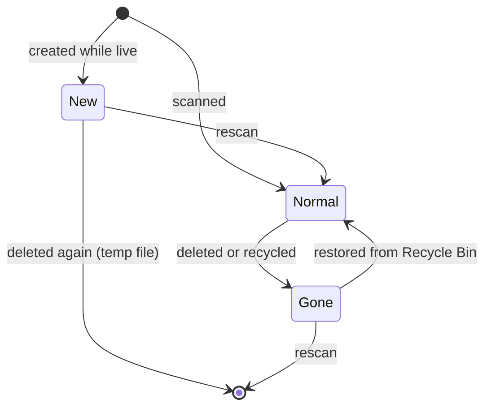
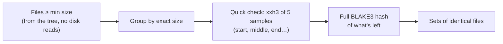

# Bulk

A fast, friendly disk space analyzer for Windows.

Bulk reads the NTFS master file table (MFT) directly, so a full scan of a drive with
1–2 million files takes about 5 seconds. After that it doesn't rescan: it follows the
NTFS change journal and keeps the picture up to date live while you browse.

It's built with Rust (scanning, data, layouts) and Svelte 5 inside Tauri 2 (the UI).

- [What it does](#what-it-does)
- [Using Bulk](#using-bulk)
- [How it works](#how-it-works)
- [Project layout](#project-layout)
- [Developing](#developing)
- [Building the installer](#building-the-installer)
- [Security model](#security-model)
- [Troubleshooting](#troubleshooting)

---

## What it does

| | |
|---|---|
| **Fast scans** | Reads the MFT through a small elevated helper: C: with ~1.5M files in about 5 s. Without it, a parallel folder walk (slower, can't see protected folders). |
| **Instant reopen** | The last snapshot of each drive loads at startup, then the change journal catches it up. No rescan needed. |
| **Live view** | New files show up as they're created, deleted ones stay greyed out until the next rescan. |
| **Tree list + charts** | A virtualized file list next to a treemap or sunburst, kept in sync. Zoom into any folder. |
| **Rescan a folder** | Rescans just the folder you're looking at, and merges it into the drive's data. Whole-drive rescan is one click away. |
| **What changed** | Compare against any earlier snapshot, scoped to the folder you're in. |
| **Search everywhere** | Ctrl+K searches every scanned drive in milliseconds: wildcards (`IMG_2024*.jpg`), paths (`Downloads/invoice`), filters like `kind:video size:>1GB modified:<30d`, exclusions and OR. Select results and send them to the cleanup cart. |
| **Filter the view** | Limit the list, treemap and sunburst to any search (`kind:video`, `size:>1GB`, …); folder sizes count only what matches. |
| **Storage by type** | How much space videos, spreadsheets, archives… take, or every extension on its own, for the drive or the folder you're in. |
| **Cleanup suggestions** | Build output, caches, old temp files and downloads you can usually delete, marked safe or check-first, ready to send to the cart. |
| **Cleanup cart** | Collect files and folders from anywhere, review, then send them to the Recycle Bin (with undo) or delete permanently. |
| **Duplicate finder** | Finds identical files by content, not name. |
| **Exports** | A shareable HTML report, CSV or JSON for the current folder, the changes, or the duplicates. |
| **Explorer integration** | "Analyze with Bulk" on any folder or drive's right-click menu. |
| **Command line** | `bulk .` opens a folder in the app; `bulk` on its own is an interactive finder; `bulk top`, `search`, `junk`, `changes`, `delete`… print tables or JSON for scripts and AI agents. |
| **Scheduled snapshots** | Optional daily or weekly snapshots in the background, even when Bulk is closed. |

---

## Using Bulk

### First launch

Bulk asks Windows for permission once, to set up its helper (see
[Fast mode](#fast-mode-and-the-helper)). Say yes and every scan after that is fast and
needs no prompt. If you say no, Bulk still works by walking folders, and the sidebar
offers to ask again.

Local drives that have never been scanned are scanned automatically. Network and cloud
drives (like Google Drive) are listed but only scanned when you ask.

### The window

```
┌───────────────────────────── title bar: search, cart, theme ─────────────────────────────┐
│ sidebar │  C: Local disk · 197 GB in 1.2M files · 37 GB free            Browse Changes │
│         │                                         Duplicates Types  Export  Rescan ▾  │
│  C: ◔   │ ┌──────────────── file list ───────────┐ ┌──────────── treemap / sunburst ────────┐ │
│  D: ◑   │ │ Users                     84.0 GB    │ │                                        │ │
│  G: ◕   │ │ Windows                   27.9 GB    │ │                                        │ │
│         │ │ …                                    │ │                                        │ │
│ ⚙       │ └──────────────────────────────────────┘ └────────────────────────────────────────┘ │
└──────────────────────────────────────────────────────────────────────────────────────────────┘
```

- **Sidebar**: one ring per drive showing how full it is. Collapse it with Ctrl+B; the
  collapsed rail still shows each drive, with details in a tooltip.
- **Drive header**: size, file count and free space (amber below 10%, red below 5%).
  Normally that's all: drives are read fast and kept up to date live. It adds
  *Fast mode off* when scans walk folders instead, and *Snapshot from …* when the
  drive isn't being kept up to date, so what you see is the last scan.
- **Tabs**: Browse, Changes, Duplicates and Types. The last three start out scoped to
  the folder you had open in Browse, and show its full path.
- **Layout**: the chart sits beside the list or below it (Settings → Layout). Drag the
  divider to resize.

### Browsing

- Click a folder in the list or chart to select it, double-click (or Enter) to open it
  in the chart, Backspace to go up.
- Hovering the chart shows the item's path relative to the folder you're in, its size
  and share.
- Colours in the chart are file types (video, images, archives, code, documents, …).
  Folders full of files too small to draw get a light hatch.
- Right-click anything (in Browse, Changes or Duplicates) for: add to cleanup cart,
  open, show in chart, show in Explorer, delete, copy path.

### Live markers

When a drive is live, the charts and list show what's happened since the last scan:

| Marker | Meaning |
|---|---|
| Green outline, "New" tag | Appeared since the last scan |
| Grey, dashed, crossed out, "Deleted" tag | Deleted since the last scan; its size is already taken off the totals |
| Faded with red stripes | In the cleanup cart (dashed red outline on the item you added) |

Rescanning a folder (or the drive) clears the markers. Files that appear and disappear
again before a rescan, like temp files, just vanish instead of leaving grey ghosts.

### Rescanning

- **Rescan folder** (Ctrl+R) rescans only the folder open in the chart and merges it in.
- **Rescan whole drive** (dropdown, or Ctrl+Shift+R) rebuilds the drive from scratch.
  The folder you were in and your selection are kept.
- **Rescan drives…** in the sidebar picks several drives at once.

With fast mode on, a whole-drive rescan of C: takes about 5 s. A huge folder (over
50,000 files) is also rescanned from the MFT, since that's quicker than walking it.

### Search (Ctrl+K)

Type to search file and folder names. Every part of the query has to match, so filters
combine freely: `kind:video size:>1GB -in:appdata sort:size`.

| Write | Example | Finds |
|---|---|---|
| Words | `tax 2024` | Names containing every word |
| Quotes | `"tax return"` | The phrase, spaces included |
| Wildcards | `IMG_2024*.jpg`, `report_v?.docx` | Whole names: `*` is any text, `?` one character |
| Path | `Downloads/invoice`, `projects/*.zip` | The name, inside those folders in that order (not necessarily directly) |
| Drive path | `C:/Users/me/Downloads/report` | Same, but starting at the drive root |
| `ext:` | `ext:mp4,mkv`, `ext:xls*`, `ext:none` | Extension; `none` is files without one |
| `kind:` | `kind:video`, `kind:spreadsheet` | A group of extensions (see [Types](#types)); `type:video` works too |
| `size:` | `size:>1GB`, `size:<10mb`, `size:100mb..2gb` | Size on disk, or a range |
| `modified:` | `modified:2024`, `modified:>2024-06`, `modified:<30d` | A year/month/day, after or before one, or within / older than an age |
| `older:` / `newer:` | `older:1y`, `newer:2w` | Modified more / less than `h`, `d`, `w`, `m`, `y` ago |
| `before:` / `after:` | `before:2024-06` | Modified before / after a date |
| `type:` | `type:dir`, `type:file` | Folders or files only |
| `is:` | `is:empty`, `is:hidden`, `is:system`, `is:new` | Empty files and folders, attributes, or new since the last scan |
| `files:` | `files:>1000` | Folders holding at least that many files |
| `in:` | `in:downloads` | Inside a folder whose name contains this |
| `under:` | `under:"C:\Users\me\Music"` | Inside exactly that folder |
| `drive:` | `drive:c,d` | Only those drives |
| `-` or `!` | `-ext:tmp`, `!in:node_modules` | Leave out anything matching |
| `\|` or `OR` | `mp4\|mkv`, `ext:pdf\|docx`, `holiday OR vacation` | Either one |
| `sort:` | `sort:size`, `small`, `name`, `newest`, `oldest`, `files` | Order of results (default: best name match, then size) |

The row under the search box picks where to look: all drives, the current drive, or
the folder open in the chart. The **?** button lists the syntax; click an example to
add it.

Results can be selected:

- Click a checkbox (or Ctrl+click a row), or press Tab to tick the highlighted one.
- Shift+click selects everything between the last one you ticked and this one;
  Shift+↑/↓ grows the selection from the keyboard.
- The checkbox above the results selects everything shown, then offers *Select all N*
  for every match (up to 10,000).

Right-click a result for the same menu as in the list (add to cart, open, show in
chart, show in Explorer, delete, copy path), plus select, add the selection to the
cart, and filter Browse. Their shortcuts work in the palette too:

| Keys | Action |
|---|---|
| Enter | Show the result in the list and chart |
| Shift+Enter / Ctrl+E | Show in Explorer |
| Ctrl+Enter | Add the selection (or the highlighted result) to the cart |
| Delete | Same, or take the highlighted result back out (when the cursor is at the end of the search text) |
| Shift+Delete | Delete the highlighted result (with confirmation) |
| Ctrl+C | Copy the path(s), unless text is selected in the search box |
| Alt+Enter | Filter Browse to these results |

The palette also runs commands (rescan, switch views, theme, settings…).

### Filtering Browse

The **Filter** button (Ctrl+Shift+F) opens a bar above the list and chart. Type any
search query there and press Enter: the list, treemap and sunburst then show only
what matches, and every folder's size counts only its matching files. The bar shows
how many files match and how much space they take. Esc or ✕ clears it.

A filter can also come from elsewhere: *Filter Browse* in the search palette (Alt+Enter)
uses the current search, and clicking a row in Types filters to that type or extension.
The filter stays while files change and across rescans. The bar also shows on the
Changes and Duplicates tabs, so you can set or change it there:

- **Changes** only compares matching files.
- **Duplicates** only looks among matching files.
- **Export** writes only what matches, from any tab, and the report says so.

### Types

The Types tab adds up the files in the drive, or in the folder open in Browse, by kind
or by extension:

| Kind | Extensions (examples) |
|---|---|
| Videos | mp4, mkv, avi, mov, webm, … |
| Images | jpg, png, heic, webp, raw camera files, … |
| Audio | mp3, flac, wav, m4a, … |
| Documents | pdf, docx, txt, md, epub, … |
| Spreadsheets | xlsx, xls, csv, tsv, ods, … |
| Presentations | pptx, ppt, key, odp, … |
| Archives | zip, rar, 7z, tar, gz, … |
| Programs | exe, dll, msi, appx, jar, … |
| System files | sys, drv, mui, cat, efi, … |
| Code | js, ts, py, rs, json, html, … |
| Disk images | iso, vhdx, vmdk, wim, … |
| Databases | db, sqlite, mdf, accdb, … |
| Design & 3D | psd, ai, fig, blend, stl, … |
| Fonts, Email, Logs & temp | ttf, otf · pst, eml · log, tmp, dmp, … |

Anything else is *Other*, and files without an extension have their own row. The bar
at the top shows the split at a glance. Click a row to filter Browse to those files, so
the list and charts show where they are; the search button on the row lists them in
the palette instead, biggest first, ready to select and add to the cart.

### Cleaning up

- **Cleanup cart**: Delete adds the selection (Delete again takes it out). Review the
  cart from the title bar, then *Move to Recycle Bin* (undoable from the toast) or
  *Delete permanently* (asks you to confirm first).
- **Delete straight away**: Shift+Del, or right-click → *Delete…*, opens a dialog with
  *Move to Recycle Bin* as the main button and *Delete permanently* beside it.

Either way, deleted items stay greyed out until the next rescan.

### Cleanup

The **Cleanup** tab lists space that can usually be got back, for the whole drive or
the folder open in Browse: build output (`node_modules`, Rust `target` folders,
Python caches and virtual environments), package manager caches, browser caches,
temp files older than a week, crash dumps and old installers in Downloads. Each kind
is marked **Safe** (rebuilt or downloaded again when needed), **Check first** (build
output still in use within 30 days, caches that make installs slower) or **Good to
know** (the Recycle Bin, Windows Update downloads, virtual disks, the page and
hibernation files, which have a button or a note instead of checkboxes). Folders that
belong to installed programs (Program Files, AppData, tools' dot-folders like
`~\.vscode`) are left out of the build-output rules.

- Tick items, or a whole kind, and *Add to cart*; *Add all safe to cart* takes
  everything marked safe. Nothing is deleted from the tab itself: it all goes through
  the cart's review and Recycle Bin.
- Click a path to show it in Browse; hover for Explorer.
- The eye button hides one item or a whole kind for good; *N hidden* brings them
  back. `bulk junk` hides the same ones.
- The drive header shows *N GB to clean up* when there's at least 100 MB marked safe;
  clicking it opens the tab.

### What changed

Pick an earlier snapshot to compare against. The list shows what grew or shrank,
biggest first; expand folders to drill down. New and deleted items are tagged. It's
scoped to the folder you had open in Browse; *Show whole drive* widens it.

A dated snapshot is saved after each full scan and, if you turn it on, on a daily or
weekly schedule. Settings → Keep sets how many dated snapshots each drive
keeps (default 7).

### Duplicates

Finds files with identical content. Options: minimum size (1 / 10 / 100 MB), only the
open folder (on by default when you came from one), and *Skip Windows and program
folders*, which skips folders named `Windows`, `Program Files`, `Program Files (x86)`,
`ProgramData`, `$Recycle.Bin`, `System Volume Information`, `$Windows.~BT`,
`$Windows.~WS` and `Recovery`. Pick copies by hand or with *Select all but the
newest/oldest*, then add them to the cleanup cart. Results stay while you switch tabs.

### Export

The Export button exports whatever tab you're on:

| Tab | HTML | CSV | JSON |
|---|---|---|---|
| Browse | Report with treemap, file types, largest folders and files | Every file and folder | Folder tree |
| Changes | Totals and the biggest changes | Every change | Every change |
| Duplicates | Every duplicate set | Every duplicate file | Every set |

It's disabled when there's nothing to export (no changes, or duplicates not searched
yet). HTML reports are single files you can send to anyone; they use the Geist font
from Google Fonts and fall back to the system font offline.

### Keyboard shortcuts

| Keys | Action |
|---|---|
| Ctrl+K / Ctrl+F | Search and commands |
| Ctrl+Shift+F | Filter the list and chart |
| Ctrl+R / F5 | Rescan open folder |
| Ctrl+Shift+R | Rescan whole drive |
| Ctrl+B | Collapse / expand sidebar |
| Ctrl+1 / Ctrl+2 | Treemap / sunburst |
| Ctrl+E | Show selection in Explorer |
| Ctrl+C | Copy path of selection |
| Delete | Add to / remove from cleanup cart |
| Shift+Delete | Delete (with confirmation) |
| Esc | Clear selection, close dialogs |
| ↑ ↓ ← → Home End | Move around the list |
| Enter | Show folder in the chart |
| Shift+Enter | Show in Explorer |
| Backspace | Zoom out |
| ? | All shortcuts |

### Settings

| Setting | Default | |
|---|---|---|
| Theme | System | System, dark or light |
| Colours | Bulk | A colour template (see below) |
| Layout | Side by side | Chart beside or below the list |
| Fast mode | On | Use the helper. Off = walk folders, no live updates; the helper stays set up so turning it back on needs no prompt |
| Automatic snapshots | Off | Background snapshots via a scheduled task, which only exists while this is on |
| How often | Daily | Daily or weekly |
| Keep | 7 | Dated snapshots per drive |
| "Analyze with Bulk" in Explorer | On | Right-click entry for folders and drives |

### Colour templates

Settings → Colours lists every template in `%LOCALAPPDATA%\Bulk\templates` (the
*Open folder* button opens it). Bulk ships five:

| Template | Look |
|---|---|
| Bulk | The original: soft violet on deep grey |
| Fern | Fresh green on dark moss |
| Tide | Clear ocean blue on midnight navy |
| Ember | Warm amber on charcoal |
| Graphite | Neutral greys with a white accent |

To make your own, copy one of the files, rename it, edit the colours, and press
*Reload* in Settings. Each template has a dark and a light half:

```json
{
  "name": "My theme",
  "description": "Shown under the name",
  "dark": {
    "ui": { "accent": "#ff5c8a", "app-bg": "#1a1014" },
    "files": { "video": "#ff6b8b", "folder": "#ff5c8a" },
    "branches": ["#ff5c8a", "#3fd0c9", "#f5b544"]
  },
  "light": { "ui": { "accent": "#d6336c" } }
}
```

- **ui**: every colour in the app, each role on its own, so a red or yellow theme
  never gets mixed up with warnings:

  | Group | Keys |
  |---|---|
  | Window and text | `app-bg`, `app-tint`, `sidebar-tint`, `panel`, `panel-2`, `popover`, `hover`, `line`, `line-strong`, `fg`, `fg-muted`, `fg-subtle`, `shadow`, `backdrop` |
  | Accent and controls | `accent`, `accent-fg`, `accent-soft`, `switch-off`, `switch-knob`, `bar-end` |
  | Messages | `danger`, `danger-fg`, `ok`, `warn` |
  | Drive usage | `usage`, `usage-low` (under 10% free), `usage-full` (under 5% free) |
  | Status | `stale` (*Snapshot from …*), `live` |
  | Markers | `added`, `removed` (live new/deleted), `cart` |
  | Changes tab | `grew`, `shrank` |
  | Charts | `chart-folder`, `chart-hatch`, `chart-hover`, `chart-hover-line`, `chart-select`, `chart-label` (or `auto`), `chart-label-folder` |
  | Title bar | `close-hover`, `close-fg`, `logo-1` … `logo-4` |

  Values can point at other colours: the default sets `usage-full` to
  `var(--danger)`, so it follows whatever a template uses for danger unless the
  template sets `usage-full` itself.
- **files**: file-type colours in the treemap, sunburst and Types tab (`folder`,
  `video`, `image`, `document`, `spreadsheet`, `code`, …).
- **branches**: the sunburst's colour for each top-level folder.

Anything left out comes from the default, so a template can be a single accent
colour. Values are any CSS colour. A file that isn't valid shows up in Settings with
the reason. Bulk keeps its own five templates up to date but never overwrites one
you've edited (it remembers what it wrote in `.shipped.json`); delete one to get the
original back.

### Command line

The installer puts `bulk` on PATH (from `C:\Program Files\Bulk\bin`). It reads the
same snapshots as the app and brings them up to date through the helper, so answers
are current without the app being open.

```bash
bulk .                       # open this folder in the app (a file opens with it selected)
bulk                         # interactive finder in this folder
bulk drives                  # free space on each drive
bulk top                     # what's biggest in this folder
bulk top C:\Users --files    # biggest files anywhere below
bulk search "kind:video size:>1GB"
bulk types ~ --ext           # space per kind of file, or per extension
bulk junk                    # space that can usually be got back
bulk changes --since 7d      # what grew or shrank in the last week
bulk dupes D:\Photos         # identical files
bulk export . -o report.html # same report as the app's Export button
bulk delete <paths>          # lists what would go; add --yes to recycle it
bulk restore                 # recent deletes; `bulk restore 3` puts one back
```

`bulk --help` and `bulk <command> --help` describe every option; `bulk search
--help` has the [search syntax](#search-ctrlk), which `--filter` options take too.
Quote searches with `|`, `>` or `<`, and use `!` rather than `-` to leave things out
(`bulk search "ext:log !in:temp"`).

**Freshness.** Each command loads the drive's last snapshot, catches it up from the
change journal, and rescans the drive (about 5 seconds) if the journal no longer
reaches back that far. `--no-scan` uses the snapshot as it is; `--rescan` always
scans. While the app is closed, the CLI saves what it caught up so the next run (or
the app) starts from there. Without fast mode, commands use the snapshot as it is.

**For scripts and agents.** Every command takes `--json`, with sizes in bytes, full
paths, ISO dates and an `asOf` block saying when the data is from and whether it's
`live`, `scanned` or a `snapshot`. Lists are cut to `-n` items with the full count in
`total`. Commands exit with 1 on an error, and `bulk delete --yes` exits with 1 if
anything wasn't deleted.

**Deleting safely.** `bulk delete`:

- only lists what it would do until you add `--yes`;
- moves things to the Recycle Bin; `--permanently-delete` skips the bin and can't be
  undone;
- refuses whole drives, Windows, Program Files, ProgramData, user and profile
  folders (Desktop, Documents, Downloads, AppData…, though what's *in* them is fine),
  files marked as system files, and Bulk's own files. If anything is refused,
  nothing is deleted;
- stops above 50 GB in one go unless `--max` says otherwise;
- takes `--query "<search>" --in <folder>` to delete everything a search finds in a
  folder (up to 10,000 items);
- logs every run in `%LOCALAPPDATA%\Bulk\deleted.jsonl`; `bulk restore <number>`
  puts recycled items back.

**`bulk junk`** looks for build output (`node_modules`, Rust `target` folders,
Python caches and virtual environments), package manager caches, browser caches,
temp files older than a week, crash dumps, old installers in Downloads, and lists
things worth knowing about but not deleting by hand (the Recycle Bin, Windows Update
downloads, virtual disks, the page and hibernation files). Each is marked `safe`,
`review` (check first; build output still in use within 30 days is marked this way)
or `info`, the same as the app's [Cleanup](#cleanup) tab, and anything hidden there
is left out here too.

**Colours.** Tables use your colour template: file-type colours on the bars, sizes
over a gigabyte in the warning colour, faint folders and bright names in paths, green
for safe and yellow for check-first. They're off when the output is piped or
`NO_COLOR` is set.

**The finder** (`bulk` or `bulk find [search] [--in folder]`) searches as you type
with the same syntax as Ctrl+K, and browses folders by size when the search is empty.
Searching runs beside the screen, like fzf: typing never waits for results, the last
results stay up until new ones arrive, and a spinner turns while a search is under
way. Matches are underlined in the names. It stays live while open. Results show
size, a bar in the file type's colour from your colour template, and the date; the
panel on the right shows details, the biggest things inside a folder and what types
fill it.

| Keys | Action |
|---|---|
| Type | Search |
| → / ← | Into a folder / up a level (at the end / start of the search) |
| Tab, Shift+Tab | Pick or unpick, and move |
| Ctrl+A | Pick everything listed |
| Enter | Print the picked paths (or the highlighted one) and quit |
| Ctrl+O / Ctrl+E / Ctrl+B | Open / show in Explorer / show in the Bulk app |
| Alt+C | Copy the paths |
| Ctrl+D | Move to the Recycle Bin, after a confirmation |
| Ctrl+R | Search this folder, the whole drive, or every drive |
| Ctrl+S | Sort by best match, size, newest or name |
| Ctrl+P / Ctrl+N | Earlier / later searches |
| Esc | Clear the search, or quit |
| F1 | All the keys |

Enter prints to stdout while the finder draws on the terminal, so it works in
pipelines like fzf: `code (bulk find ext:log)` in PowerShell. `--print0` separates
paths with NUL, `--json` prints full details.

---

## How it works

### Architecture

Bulk is two programs. The app runs as you, with normal rights. A small helper runs
elevated, because reading a drive's MFT and change journal needs admin rights. They
talk over a named pipe that only your account can open.



The helper is read-only: it scans and reports changes, nothing more. Deleting,
recycling and everything else happens in the normal app, as you.

### Fast mode and the helper

On first launch Bulk runs `bulk-helper.exe --install`, which Windows shows as one UAC
prompt. That registers a scheduled task, `Bulk\Helper`, with "run with highest
privileges". From then on the app starts the helper by running that task, which needs
no prompt. The helper exits by itself after 10 idle minutes.



Turning fast mode off just stops using the helper; the task stays registered. Only the
uninstaller removes it.

### Scanning



**MFT reader** (`crates/bulk-core/src/scan/mft.rs`): opens `\\.\C:`, finds where the
MFT lives from its own record 0, and reads it in 4 MB chunks with overlapped I/O
while rayon parses records in parallel. For each record it applies the NTFS fixups and
reads the standard information (timestamps, attributes), file names (the parent
reference builds the tree) and data sizes (allocated size, sparse, compressed). Hard
links are counted once, cloud placeholders (OneDrive, Google Drive) are flagged so they
don't count as disk usage, and `$BadClus` is ignored.

**Folder walker** (`scan/walk.rs`): used for non-NTFS drives, without the helper, and
for small folder rescans. One thread per folder via rayon, `FindFirstFileExW` with large
fetches, junctions and symlinks listed but not followed.

**Tree model** (`tree.rs`): every file and folder is a fixed 56-byte node in one array,
with children as linked lists and all names in one shared string buffer (plus a
lowercase copy for search). C: with 1.5M files fits in roughly 150 MB of RAM. Folder
totals are aggregated bottom-up once, then kept up to date incrementally.

### Live updates



The journal says *which* files changed. The helper then reads each one's current MFT
record, so the app gets the new name, parent, size and attributes, and applies them
to the tree by file id. If the journal can't cover the gap (it's been too long, or it
was reset), the drive is rescanned instead.

### Live markers



*Gone* items keep their place (greyed out) but are no longer counted in any total, and
search, duplicates, exports and snapshots skip them. A move into `$Recycle.Bin` counts
as a deletion where the file used to be.

### Snapshots

`%LOCALAPPDATA%\Bulk\snapshots\<volume serial>\`:

- `current.bulk`: the latest state, used for instant reopen. Saved after scans and when
  Bulk closes.
- `history\<unix time>.bulk`: dated snapshots for the Changes tab, pruned to the
  *Keep* setting.

The format is a small header and JSON metadata (drive, time, scan method, totals,
journal position), then the tree as a compact binary layout compressed with zstd. C:
comes to about 25–40 MB. Volume serials are used instead of letters, so a USB drive is
recognised whatever letter it gets.

### Charts

Layouts are computed in Rust and sent to the webview as packed binary arrays (no JSON),
then drawn on a canvas:

- **Treemap**: squarified, with folder name strips, a budget of about 24,000 tiles,
  and tiles under 6 px² skipped (their folder is hatched instead).
- **Sunburst**: up to 6 rings, each top-level folder in its own hue.

Zooming animates between the old and new layout. Live updates compare the new layout
with what's on screen byte for byte and skip the redraw if nothing visible changed, so
the tooltip stays put while other programs write files.

### Search

The query is parsed into terms that all have to match; each term is a list of
alternatives (from `|` or `OR`), and may be negated. Terms that only look at the node
itself (name, size, date, kind) are checked first; those that walk up the parent
folders (paths, `in:`, `under:`) only run for nodes that survive. Every node of every
drive in scope is checked in parallel, with `memchr` for substrings and a small
wildcard matcher for `*` and `?`. Results are ranked by how well the name matches
(exact, then prefix, then start of a word, then anywhere), then by size, unless
`sort:` says otherwise. Searching 1.4M files takes tens of milliseconds.

### Duplicate finder



Most files are ruled out by size alone; the sampled hash removes almost all the rest
after reading a few KB per file; only real candidates are read in full. A search of a
user folder takes about 10 s.

### Changes

The snapshot and the live tree have different internal ids, so items are matched by
name, folder by folder (`diff.rs`). Only items that changed are returned, biggest
change first, and folders are only compared when you expand them.

---

## Project layout

```
crates/
  bulk-core/            everything that isn't UI, shared by the app, helper and CLI
    src/
      drive.rs          a drive's tree without the app: snapshot, catch-up or scan
      os.rs             open, show in Explorer, find the app and install folder
      junk.rs           reclaimable space rules for `bulk junk`
      scan/mft.rs       NTFS MFT reader
      scan/walk.rs      parallel folder walker
      tree.rs           arena tree, aggregation, live edits, merge, gone/new marks
      usn.rs            change journal: read, file-id index, apply changes
      helper.rs         pipe protocol, client, task install/run
      snapshot.rs       save/load/prune .bulk files
      layout.rs         treemap and sunburst layouts, file-type categories
      search.rs         query language and parallel search
      kinds.rs          file kinds by extension, storage per kind/extension
      filter.rs         a search applied to the tree: sizes counting only matches
      diff.rs           snapshot vs live comparison
      dupes.rs          duplicate finder
      export.rs         HTML/CSV/JSON reports (folder, changes, duplicates)
      trash.rs          Recycle Bin, permanent delete, restore, protected paths
      settings.rs       settings.json shared with the helper
      volume.rs         drive list, types, free space
    examples/           bench.rs, compare.rs, dupebench.rs
  bulk-helper/
    src/main.rs         elevated helper: --serve, --install, --uninstall, --snapshot-all
    src/bin/probe.rs    dev tool: scan through the helper, or ask it to exit
  bulk-cli/             the `bulk` command (built as bulk-cli.exe, installed as bin\bulk.exe)
    src/
      main.rs           commands and the search syntax help
      load.rs           loading drives with progress, typed paths, --json freshness
      read.rs           drives, top, search, types
      report.rs         changes, snapshots, junk, dupes, export
      delete.rs         delete, restore, the delete log
      find.rs           the interactive finder (ratatui)
      theme.rs          colours from the app's colour template
      out.rs            sizes, dates, tables, JSON
src-tauri/              Bulk.exe backend
  src/
    lib.rs              app setup, command registration
    state.rs            per-drive state: tree, list view, journal, live watch
    scan.rs             helper status, fast mode, full and folder scans
    live.rs             restore at startup, catch-up, live watching, saving
    commands.rs         list rows, layouts, search, node info, export, open/show
    history.rs          snapshot list, diff, change/duplicate exports
    cart.rs             cleanup cart, delete, undo
    cleanup.rs          Cleanup tab: suggestions, hidden ones, Recycle Bin and Disk Cleanup
    dupes.rs            duplicate search commands
    settings.rs         settings commands, snapshot storage info
    templates.rs        colour templates folder: shipped files, listing
  templates/            the colour templates Bulk ships (JSON)
    shell.rs            Explorer menu, single instance, "--open"
    win.rs              Mica backdrop
  installer/hooks.nsh   NSIS install/uninstall hooks
src/                    Svelte 5 UI
  App.svelte            shell and global shortcuts
  lib/app.svelte.ts     app state (drives, scans, selection, cart, toasts…)
  lib/api.ts            typed Tauri commands and binary decoders
  lib/components/       TitleBar, Sidebar, Explorer, TreeList, Treemap, Sunburst,
                        DiffView, DupesView, TypesView, CleanupView, CommandPalette,
                        CartPanel, dialogs…
```

---

## Developing

### Requirements

- Windows 10 or 11
- Rust (stable, MSVC toolchain) and the Visual Studio C++ build tools
- Node 20+ and pnpm

### Run

```bash
pnpm install
pnpm tauri dev
```

The dev build uses its own helper task (`Bulk\HelperDev`) and pipe, so it doesn't
interfere with an installed copy. The first run asks for elevation once to register it.

`pnpm dev:app` (run automatically by `tauri dev`) asks a running dev helper to exit
before rebuilding it, because Windows locks a running exe.

The CLI builds as `target\debug\bulk-cli.exe` (so it doesn't overwrite the app's
`bulk.exe` there); it uses the dev helper because it sits in the same folder:

```bash
cargo build -p bulk-cli
.\target\debug\bulk-cli.exe top .
```

### Checks

```bash
cargo test -p bulk-core -p bulk-cli
cargo clippy --workspace
pnpm check
pnpm format
```

### Tools

```bash
# time a scan (mft needs an elevated terminal)
cargo run --release -p bulk-core --example bench -- C: walk
cargo run --release -p bulk-core --example bench -- C: mft

# scan through the running helper, or ask it to exit
cargo run --release -p bulk-helper --bin probe -- C
cargo run -p bulk-helper --bin probe -- --shutdown
```

The helper logs to `%LOCALAPPDATA%\Bulk\helper.log`.

### Things worth knowing

- **AppData redirection:** a dev app launched from inside a packaged (MSIX) app, such
  as the Claude desktop app, has its `%LOCALAPPDATA%` writes redirected into that
  package's folder (`…\Packages\<app>\LocalCache\Local\Bulk`). Settings → Open folder
  finds the real location. Installed builds aren't affected.
- **Stale builds:** if a dev build fails to link with "unresolved external symbol
  anon.…", it's a stale incremental build of `bulk-core`; `cargo clean -p bulk-core`
  fixes it.
- `bulk-core` is built optimised even in dev (see `Cargo.toml`), because scans are far
  too slow without it.

---

## Building the installer

```bash
pnpm bundle
```

This builds the release helper, CLI and app and produces a per-machine NSIS installer
in `target/release/bundle/nsis/`. `tauri.release.conf.json` adds the helper and the
CLI (as `bin\bulk.exe`) to the installer; it's kept out of the main config because
Tauri would otherwise copy the helper over the dev helper in `target/debug`.

The installer:

- installs into Program Files (see [Security model](#security-model) for why),
- stops a running helper before upgrading,
- adds `bin` (only the CLI, not `Bulk.exe`) to the system PATH,
- on uninstall, runs `bulk-helper --uninstall` (removes both scheduled tasks),
  removes the Explorer menu entries and takes `bin` off PATH.

---

## Security model

- **Installed in Program Files.** The helper task runs `bulk-helper.exe` elevated
  without a prompt, so the exe must not be writable by normal programs; otherwise any
  program could swap it and gain admin rights. Dev builds run the helper from `target\`,
  which is fine only on your own machine while developing.
- **Pipe access.** The pipe's security descriptor admits only your account and SYSTEM,
  and the helper also checks that the connecting program is in its own folder (or,
  for the CLI, its `bin` subfolder; both are in Program Files).
- **Read-only helper.** It scans and reports changes; it can also create or delete its
  own snapshot task. It never deletes or writes your files.
- **Deleting happens as you.** Recycling and permanent deletes run in the normal app
  or CLI with your own rights, through the Windows shell. The CLI also refuses
  system, program and profile folders outright.
- **Explorer menu** entries are per-user (`HKCU`) and point at the installed app.

---

## Troubleshooting

| Problem | What to do |
|---|---|
| Scans are slow and protected folders are missing | Fast mode is off or wasn't allowed. Settings → Fast mode, or the sidebar's *Allow*. |
| "Fast mode needs permission" after updating | The helper task points at an older copy; *Allow* re-registers it. |
| A drive shows *Snapshot from …* | It was scanned with the folder walk (no journal position). Rescan the whole drive with fast mode on. |
| Changes tab says a snapshot came from a standard scan | That snapshot was a folder walk, which can't see protected folders, so some differences are just what it couldn't see. Pick one taken with fast mode. |
| Lots of grey "Deleted" items | They're cleared by rescanning the folder (Ctrl+R). |
| Snapshot folder looks empty in Explorer | You're running a dev build from inside a packaged app; use Settings → Open folder. |
