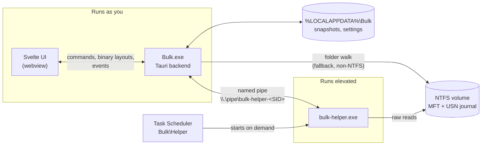
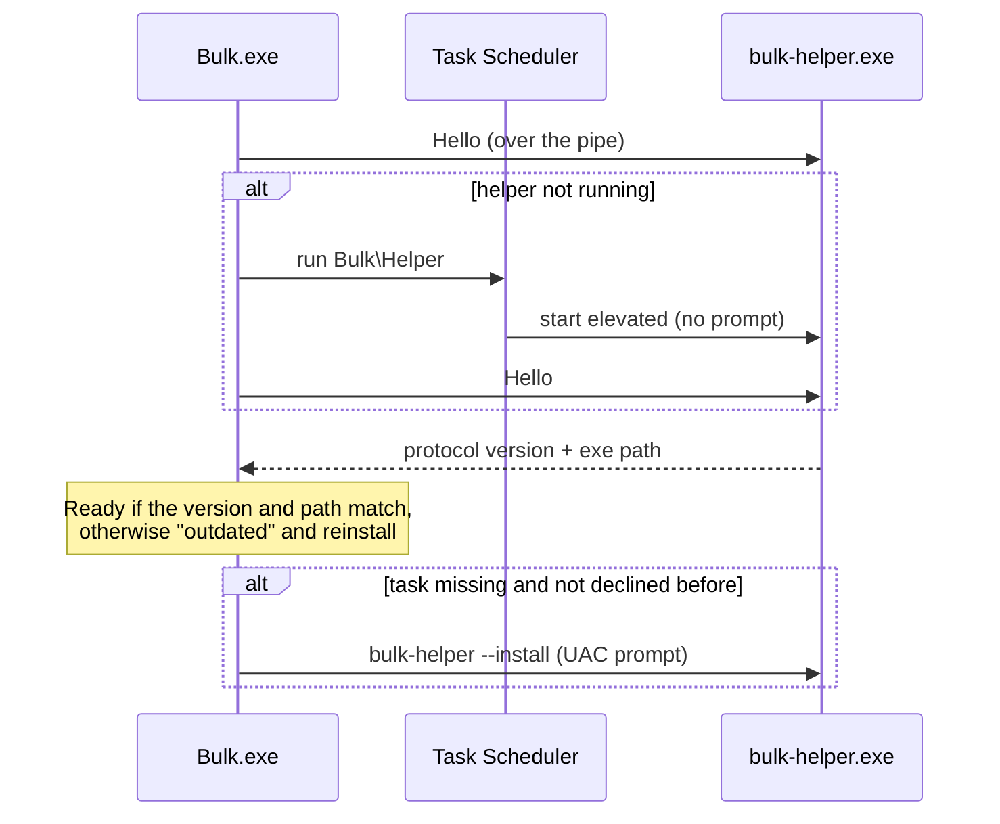
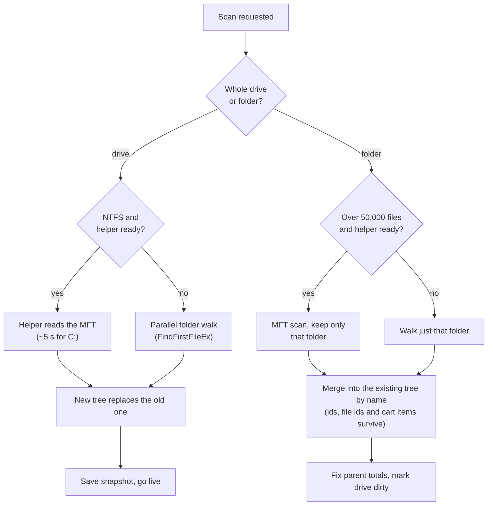
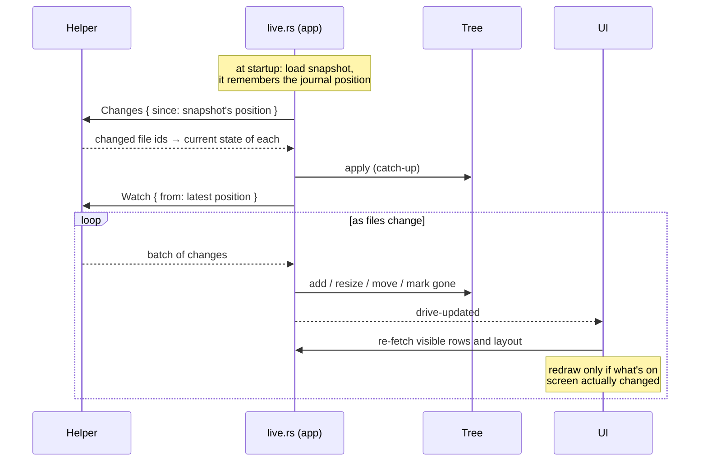
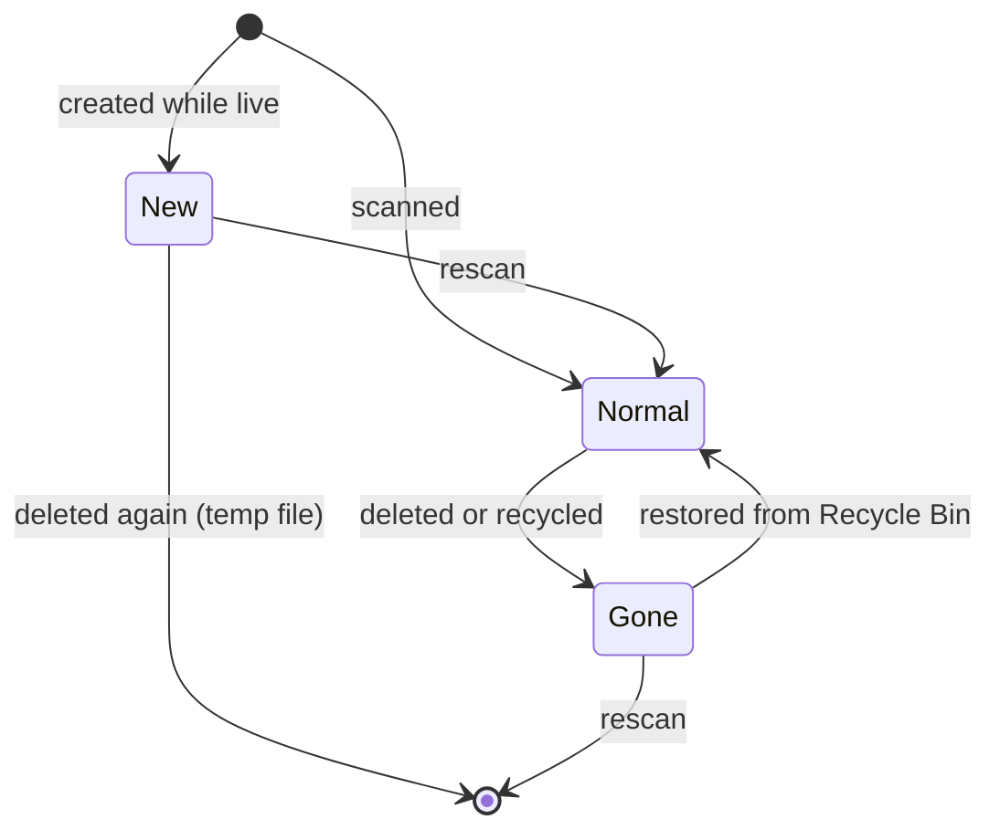
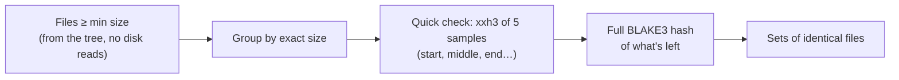

# Bulk

A fast, friendly disk space analyzer for Windows.

Bulk reads the NTFS master file table (MFT) directly, so a full scan of a drive with
1–2 million files takes about 5 seconds. After that it doesn't rescan: it follows the
NTFS change journal and keeps the picture up to date live while you browse.

It's built with Rust (scanning, data, layouts) and Svelte 5 inside Tauri 2 (the UI).

- [What it does](#what-it-does)
- [Using Bulk](#using-bulk)
- [How it works](#how-it-works)
- [Project layout](#project-layout)
- [Developing](#developing)
- [Building the installer](#building-the-installer)
- [Security model](#security-model)
- [Troubleshooting](#troubleshooting)

---

## What it does

| | |
|---|---|
| **Fast scans** | Reads the MFT through a small elevated helper: C: with ~1.5M files in about 5 s. Without it, a parallel folder walk (slower, can't see protected folders). |
| **Instant reopen** | The last snapshot of each drive loads at startup, then the change journal catches it up. No rescan needed. |
| **Live view** | New files show up as they're created, deleted ones stay greyed out until the next rescan. |
| **Tree list + charts** | A virtualized file list next to a treemap or sunburst, kept in sync. Zoom into any folder. |
| **Rescan a folder** | Rescans just the folder you're looking at, and merges it into the drive's data. Whole-drive rescan is one click away. |
| **What changed** | Compare against any earlier snapshot, scoped to the folder you're in. |
| **Search everywhere** | Ctrl+K searches every scanned drive in milliseconds, with filters like `ext:mp4 size:>1GB older:1y`. |
| **Cleanup cart** | Collect files and folders from anywhere, review, then send them to the Recycle Bin (with undo) or delete permanently. |
| **Duplicate finder** | Finds identical files by content, not name. |
| **Exports** | A shareable HTML report, CSV or JSON for the current folder, the changes, or the duplicates. |
| **Explorer integration** | "Analyze with Bulk" on any folder or drive's right-click menu. |
| **Scheduled snapshots** | Optional daily or weekly snapshots in the background, even when Bulk is closed. |

---

## Using Bulk

### First launch

Bulk asks Windows for permission once, to set up its helper (see
[Fast mode](#fast-mode-and-the-helper)). Say yes and every scan after that is fast and
needs no prompt. If you say no, Bulk still works by walking folders, and the sidebar
offers to ask again.

Local drives that have never been scanned are scanned automatically. Network and cloud
drives (like Google Drive) are listed but only scanned when you ask.

### The window

```
┌───────────────────────────── title bar: search, cart, theme ─────────────────────────────┐
│ sidebar │  C: Local disk · 197 GB in 1.2M files · 37 GB free · Fast · Live   Browse Changes │
│         │                                                     Duplicates  Export  Rescan ▾  │
│  C: ◔   │ ┌──────────────── file list ───────────┐ ┌──────────── treemap / sunburst ────────┐ │
│  D: ◑   │ │ Users                     84.0 GB    │ │                                        │ │
│  G: ◕   │ │ Windows                   27.9 GB    │ │                                        │ │
│         │ │ …                                    │ │                                        │ │
│ ⚙       │ └──────────────────────────────────────┘ └────────────────────────────────────────┘ │
└──────────────────────────────────────────────────────────────────────────────────────────────┘
```

- **Sidebar**: one ring per drive showing how full it is. Collapse it with Ctrl+B; the
  collapsed rail still shows each drive, with details in a tooltip.
- **Drive header**: size, file count, free space (amber below 10%, red below 5%), how
  it was scanned (*Fast* = MFT) and whether it's *Live*.
- **Tabs**: Browse, Changes and Duplicates. Changes and Duplicates start out scoped to
  the folder you had open in Browse, and show its full path.
- **Layout**: the chart sits beside the list or below it (Settings → Layout). Drag the
  divider to resize.

### Browsing

- Click a folder in the list or chart to select it, double-click (or Enter) to open it
  in the chart, Backspace to go up.
- Hovering the chart shows the item's path relative to the folder you're in, its size
  and share.
- Colours in the chart are file types (video, images, archives, code, documents, …).
  Folders full of files too small to draw get a light hatch.
- Right-click anything (in Browse, Changes or Duplicates) for: add to cleanup cart,
  open, show in chart, show in Explorer, delete, copy path.

### Live markers

When a drive is live, the charts and list show what's happened since the last scan:

| Marker | Meaning |
|---|---|
| Green outline, "New" tag | Appeared since the last scan |
| Grey, dashed, crossed out, "Deleted" tag | Deleted since the last scan; its size is already taken off the totals |
| Faded with red stripes | In the cleanup cart (dashed red outline on the item you added) |

Rescanning a folder (or the drive) clears the markers. Files that appear and disappear
again before a rescan, like temp files, just vanish instead of leaving grey ghosts.

### Rescanning

- **Rescan folder** (Ctrl+R) rescans only the folder open in the chart and merges it in.
- **Rescan whole drive** (dropdown, or Ctrl+Shift+R) rebuilds the drive from scratch.
  The folder you were in and your selection are kept.
- **Rescan drives…** in the sidebar picks several drives at once.

With fast mode on, a whole-drive rescan of C: takes about 5 s. A huge folder (over
50,000 files) is also rescanned from the MFT, since that's quicker than walking it.

### Search (Ctrl+K)

Type words to match file and folder names on every scanned drive. Add filters:

| Filter | Example | Meaning |
|---|---|---|
| `ext:` | `ext:mp4,mkv` | Extension (comma-separated) |
| `size:` | `size:>1GB`, `size:<10mb`, `size:100mb..2gb` | Size, or a range |
| `older:` / `newer:` | `older:1y`, `newer:2w` | Modified more / less than `d`, `w`, `m`, `y` ago |
| `before:` / `after:` | `before:2024-06` | Modified before / after a date (`YYYY`, `YYYY-MM`, `YYYY-MM-DD`) |
| `type:` | `type:dir`, `type:file` | Folders or files only |
| `in:` | `in:downloads` | Inside a folder whose name contains this |

Enter opens the result in the list and chart; Shift+Enter shows it in Explorer. The
palette also runs commands (rescan, switch views, theme, settings…).

### Cleaning up

- **Cleanup cart**: Delete adds the selection (Delete again takes it out). Review the
  cart from the title bar, then *Move to Recycle Bin* (undoable from the toast) or
  *Delete permanently* (asks you to confirm first).
- **Delete straight away**: Shift+Del, or right-click → *Delete…*, opens a dialog with
  *Move to Recycle Bin* as the main button and *Delete permanently* beside it.

Either way, deleted items stay greyed out until the next rescan.

### What changed

Pick an earlier snapshot to compare against. The list shows what grew or shrank,
biggest first; expand folders to drill down. New and deleted items are tagged. It's
scoped to the folder you had open in Browse; *Show whole drive* widens it.

A dated snapshot is saved after each full scan and, if you turn it on, on a daily or
weekly schedule. Settings → Keep sets how many dated snapshots each drive
keeps (default 7).

### Duplicates

Finds files with identical content. Options: minimum size (1 / 10 / 100 MB), only the
open folder (on by default when you came from one), and *Skip Windows and program
folders*, which skips folders named `Windows`, `Program Files`, `Program Files (x86)`,
`ProgramData`, `$Recycle.Bin`, `System Volume Information`, `$Windows.~BT`,
`$Windows.~WS` and `Recovery`. Pick copies by hand or with *Select all but the
newest/oldest*, then add them to the cleanup cart. Results stay while you switch tabs.

### Export

The Export button exports whatever tab you're on:

| Tab | HTML | CSV | JSON |
|---|---|---|---|
| Browse | Report with treemap, file types, largest folders and files | Every file and folder | Folder tree |
| Changes | Totals and the biggest changes | Every change | Every change |
| Duplicates | Every duplicate set | Every duplicate file | Every set |

It's disabled when there's nothing to export (no changes, or duplicates not searched
yet). HTML reports are single files you can send to anyone; they use the Geist font
from Google Fonts and fall back to the system font offline.

### Keyboard shortcuts

| Keys | Action |
|---|---|
| Ctrl+K / Ctrl+F | Search and commands |
| Ctrl+R / F5 | Rescan open folder |
| Ctrl+Shift+R | Rescan whole drive |
| Ctrl+B | Collapse / expand sidebar |
| Ctrl+1 / Ctrl+2 | Treemap / sunburst |
| Ctrl+E | Show selection in Explorer |
| Ctrl+C | Copy path of selection |
| Delete | Add to / remove from cleanup cart |
| Shift+Delete | Delete (with confirmation) |
| Esc | Clear selection, close dialogs |
| ↑ ↓ ← → Home End | Move around the list |
| Enter | Show folder in the chart |
| Shift+Enter | Show in Explorer |
| Backspace | Zoom out |
| ? | All shortcuts |

### Settings

| Setting | Default | |
|---|---|---|
| Theme | System | System, dark or light |
| Layout | Side by side | Chart beside or below the list |
| Fast mode | On | Use the helper. Off = walk folders, no live updates; the helper stays set up so turning it back on needs no prompt |
| Automatic snapshots | Off | Background snapshots via a scheduled task, which only exists while this is on |
| How often | Daily | Daily or weekly |
| Keep | 7 | Dated snapshots per drive |
| "Analyze with Bulk" in Explorer | On | Right-click entry for folders and drives |

---

## How it works

### Architecture

Bulk is two programs. The app runs as you, with normal rights. A small helper runs
elevated, because reading a drive's MFT and change journal needs admin rights. They
talk over a named pipe that only your account can open.



The helper is read-only: it scans and reports changes, nothing more. Deleting,
recycling and everything else happens in the normal app, as you.

### Fast mode and the helper

On first launch Bulk runs `bulk-helper.exe --install`, which Windows shows as one UAC
prompt. That registers a scheduled task, `Bulk\Helper`, with "run with highest
privileges". From then on the app starts the helper by running that task, which needs
no prompt. The helper exits by itself after 10 idle minutes.



Turning fast mode off just stops using the helper; the task stays registered. Only the
uninstaller removes it.

### Scanning



**MFT reader** (`crates/bulk-core/src/scan/mft.rs`): opens `\\.\C:`, finds where the
MFT lives from its own record 0, and reads it in 4 MB chunks with overlapped I/O
while rayon parses records in parallel. For each record it applies the NTFS fixups and
reads the standard information (timestamps, attributes), file names (the parent
reference builds the tree) and data sizes (allocated size, sparse, compressed). Hard
links are counted once, cloud placeholders (OneDrive, Google Drive) are flagged so they
don't count as disk usage, and `$BadClus` is ignored.

**Folder walker** (`scan/walk.rs`): used for non-NTFS drives, without the helper, and
for small folder rescans. One thread per folder via rayon, `FindFirstFileExW` with large
fetches, junctions and symlinks listed but not followed.

**Tree model** (`tree.rs`): every file and folder is a fixed 56-byte node in one array,
with children as linked lists and all names in one shared string buffer (plus a
lowercase copy for search). C: with 1.5M files fits in roughly 150 MB of RAM. Folder
totals are aggregated bottom-up once, then kept up to date incrementally.

### Live updates



The journal says *which* files changed. The helper then reads each one's current MFT
record, so the app gets the new name, parent, size and attributes, and applies them
to the tree by file id. If the journal can't cover the gap (it's been too long, or it
was reset), the drive is rescanned instead.

### Live markers



*Gone* items keep their place (greyed out) but are no longer counted in any total, and
search, duplicates, exports and snapshots skip them. A move into `$Recycle.Bin` counts
as a deletion where the file used to be.

### Snapshots

`%LOCALAPPDATA%\Bulk\snapshots\<volume serial>\`:

- `current.bulk`: the latest state, used for instant reopen. Saved after scans and when
  Bulk closes.
- `history\<unix time>.bulk`: dated snapshots for the Changes tab, pruned to the
  *Keep* setting.

The format is a small header and JSON metadata (drive, time, scan method, totals,
journal position), then the tree as a compact binary layout compressed with zstd. C:
comes to about 25–40 MB. Volume serials are used instead of letters, so a USB drive is
recognised whatever letter it gets.

### Charts

Layouts are computed in Rust and sent to the webview as packed binary arrays (no JSON),
then drawn on a canvas:

- **Treemap**: squarified, with folder name strips, a budget of about 24,000 tiles,
  and tiles under 6 px² skipped (their folder is hatched instead).
- **Sunburst**: up to 6 rings, each top-level folder in its own hue.

Zooming animates between the old and new layout. Live updates compare the new layout
with what's on screen byte for byte and skip the redraw if nothing visible changed, so
the tooltip stays put while other programs write files.

### Search

The lowercase name buffer is split across cores and scanned with `memchr`. Each hit
is then checked against the filters. Results are ranked by how well the name matches
(exact, then prefix, then start of a word, then anywhere), then by size. Searching every drive takes milliseconds.

### Duplicate finder



Most files are ruled out by size alone; the sampled hash removes almost all the rest
after reading a few KB per file; only real candidates are read in full. A search of a
user folder takes about 10 s.

### Changes

The snapshot and the live tree have different internal ids, so items are matched by
name, folder by folder (`diff.rs`). Only items that changed are returned, biggest
change first, and folders are only compared when you expand them.

---

## Project layout

```
crates/
  bulk-core/            everything that isn't UI; reusable for a future CLI/TUI
    src/
      scan/mft.rs       NTFS MFT reader
      scan/walk.rs      parallel folder walker
      tree.rs           arena tree, aggregation, live edits, merge, gone/new marks
      usn.rs            change journal: read, file-id index, apply changes
      helper.rs         pipe protocol, client, task install/run
      snapshot.rs       save/load/prune .bulk files
      layout.rs         treemap and sunburst layouts, file-type categories
      search.rs         query parser and parallel name search
      diff.rs           snapshot vs live comparison
      dupes.rs          duplicate finder
      export.rs         HTML/CSV/JSON reports (folder, changes, duplicates)
      trash.rs          Recycle Bin, permanent delete, restore
      settings.rs       settings.json shared with the helper
      volume.rs         drive list, types, free space
    examples/           bench.rs, compare.rs, dupebench.rs
  bulk-helper/
    src/main.rs         elevated helper: --serve, --install, --uninstall, --snapshot-all
    src/bin/probe.rs    dev tool: scan through the helper, or ask it to exit
src-tauri/              Bulk.exe backend
  src/
    lib.rs              app setup, command registration
    state.rs            per-drive state: tree, list view, journal, live watch
    scan.rs             helper status, fast mode, full and folder scans
    live.rs             restore at startup, catch-up, live watching, saving
    commands.rs         list rows, layouts, search, node info, export, open/show
    history.rs          snapshot list, diff, change/duplicate exports
    cart.rs             cleanup cart, delete, undo
    dupes.rs            duplicate search commands
    settings.rs         settings commands, snapshot storage info
    shell.rs            Explorer menu, single instance, "--open"
    win.rs              Mica backdrop
  installer/hooks.nsh   NSIS install/uninstall hooks
src/                    Svelte 5 UI
  App.svelte            shell and global shortcuts
  lib/app.svelte.ts     app state (drives, scans, selection, cart, toasts…)
  lib/api.ts            typed Tauri commands and binary decoders
  lib/components/       TitleBar, Sidebar, Explorer, TreeList, Treemap, Sunburst,
                        DiffView, DupesView, CommandPalette, CartPanel, dialogs…
```

---

## Developing

### Requirements

- Windows 10 or 11
- Rust (stable, MSVC toolchain) and the Visual Studio C++ build tools
- Node 20+ and pnpm

### Run

```bash
pnpm install
pnpm tauri dev
```

The dev build uses its own helper task (`Bulk\HelperDev`) and pipe, so it doesn't
interfere with an installed copy. The first run asks for elevation once to register it.

`pnpm dev:app` (run automatically by `tauri dev`) asks a running dev helper to exit
before rebuilding it, because Windows locks a running exe.

### Checks

```bash
cargo test -p bulk-core
cargo clippy --workspace
pnpm check
pnpm format
```

### Tools

```bash
# time a scan (mft needs an elevated terminal)
cargo run --release -p bulk-core --example bench -- C: walk
cargo run --release -p bulk-core --example bench -- C: mft

# scan through the running helper, or ask it to exit
cargo run --release -p bulk-helper --bin probe -- C
cargo run -p bulk-helper --bin probe -- --shutdown
```

The helper logs to `%LOCALAPPDATA%\Bulk\helper.log`.

### Things worth knowing

- **AppData redirection:** a dev app launched from inside a packaged (MSIX) app, such
  as the Claude desktop app, has its `%LOCALAPPDATA%` writes redirected into that
  package's folder (`…\Packages\<app>\LocalCache\Local\Bulk`). Settings → Open folder
  finds the real location. Installed builds aren't affected.
- **Stale builds:** if a dev build fails to link with "unresolved external symbol
  anon.…", it's a stale incremental build of `bulk-core`; `cargo clean -p bulk-core`
  fixes it.
- `bulk-core` is built optimised even in dev (see `Cargo.toml`), because scans are far
  too slow without it.

---

## Building the installer

```bash
pnpm bundle
```

This builds the release helper and app and produces a per-machine NSIS installer in
`target/release/bundle/nsis/`. `tauri.release.conf.json` adds the helper to the
installer; it's kept out of the main config because Tauri would otherwise copy it over
the dev helper in `target/debug`.

The installer:

- installs into Program Files (see [Security model](#security-model) for why),
- stops a running helper before upgrading,
- on uninstall, runs `bulk-helper --uninstall` (removes both scheduled tasks) and
  removes the Explorer menu entries.

---

## Security model

- **Installed in Program Files.** The helper task runs `bulk-helper.exe` elevated
  without a prompt, so the exe must not be writable by normal programs; otherwise any
  program could swap it and gain admin rights. Dev builds run the helper from `target\`,
  which is fine only on your own machine while developing.
- **Pipe access.** The pipe's security descriptor admits only your account and SYSTEM,
  and the helper also checks that the connecting program is in its own folder.
- **Read-only helper.** It scans and reports changes; it can also create or delete its
  own snapshot task. It never deletes or writes your files.
- **Deleting happens as you.** Recycling and permanent deletes run in the normal app
  with your own rights, through the Windows shell.
- **Explorer menu** entries are per-user (`HKCU`) and point at the installed app.

---

## Troubleshooting

| Problem | What to do |
|---|---|
| Scans are slow and protected folders are missing | Fast mode is off or wasn't allowed. Settings → Fast mode, or the sidebar's *Allow*. |
| "Fast mode needs permission" after updating | The helper task points at an older copy; *Allow* re-registers it. |
| A drive isn't *Live* | It was scanned with the folder walk (no journal position). Rescan the whole drive with fast mode on. |
| Changes tab says a snapshot came from a standard scan | That snapshot was a folder walk, which can't see protected folders, so some differences are just what it couldn't see. Pick one taken with fast mode. |
| Lots of grey "Deleted" items | They're cleared by rescanning the folder (Ctrl+R). |
| Snapshot folder looks empty in Explorer | You're running a dev build from inside a packaged app; use Settings → Open folder. |
